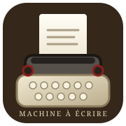

<p align="center">
  
</p>

<h1 align="center">MODÈLE 80</h1>
<p align="center"><strong>Une machine à écrire vintage, directement dans votre navigateur.</strong><br>
<strong>A vintage typewriter experience, right in your browser.</strong></p>

<p align="center">
  
  
  
  
</p>

<p align="center">
  <a href="#français">Français</a> · <a href="#english">English</a>
</p>

---

## Français

### L’expérience

**Modèle 80** est une simulation interactive inspirée des machines à écrire mécaniques. Une scène dessinée en CSS, une feuille qui se remplit au fil de la frappe et des effets sonores synthétisés par le navigateur recréent l’atmosphère d’un atelier d’écriture vintage — sans framework ni installation.

### Aperçu

<p align="center">
  
</p>

<p align="center"><em>Aperçu illustratif en SVG — ce visuel est une illustration de l’interface, pas une capture d’écran du navigateur.</em></p>

> Pour ajouter de vraies captures d’écran, placez les images dans `assets/screenshots/` et remplacez l’aperçu ci-dessus par les fichiers capturés.

### Fonctionnalités

- **Frappe interactive** : les caractères apparaissent sur la feuille et le chariot se déplace à chaque frappe.
- **Gestes mécaniques animés** : frappe, retour du chariot et avance de la feuille.
- **Audio généré à la volée** avec la Web Audio API : frappe, espace, sonnerie de marge et retour du chariot.
- **Commandes clavier** : retour à la ligne, correction et nouvelle feuille.
- **Mise à l’échelle adaptative** de la scène pour s’ajuster à la fenêtre du navigateur.
- **Ambiance vintage** : clavier AZERTY, typographies rétro et machine dessinée en CSS.

### Démarrage rapide

Aucune compilation ni dépendance à installer.

1. Clonez ou téléchargez le dépôt.
2. Ouvrez `index.html` dans un navigateur moderne.
3. Cliquez sur **« Charger la feuille »** pour démarrer et autoriser l’audio.
4. Tapez avec votre clavier physique.

```bash
git clone https://github.com/Papabibo/machine-a-ecrire.git
cd machine-a-ecrire
# Ouvrez index.html dans votre navigateur
```

Les polices **Courier Prime** et **Special Elite** sont chargées depuis Google Fonts. Une connexion Internet est nécessaire pour les récupérer ; des polices système de remplacement sont prévues.

### Commandes

| Touche | Action |
| --- | --- |
| Lettres et ponctuation | Frapper un caractère |
| Espace | Insérer un espace |
| `Entrée` | Effectuer un retour chariot |
| `Backspace` | Corriger |
| `Échap` | Recommencer sur une nouvelle feuille |
| Bouton haut droit | Activer ou couper le son |

### Notes techniques

- **Architecture** : application autonome en un seul fichier, `index.html` ; structure HTML, styles CSS et JavaScript intégrés.
- **Rendu** : éléments DOM et CSS, animations via Web Animations API.
- **Audio** : sons synthétisés avec `AudioContext` après le clic de démarrage, conformément aux restrictions d’autoplay des navigateurs.
- **Typographie** : polices web avec alternatives système.
- **Aucune étape de build, aucun paquet npm et aucun serveur requis** pour l’usage local.

### Arborescence

```text
.
├── index.html          # Application autonome
├── README.md           # Documentation bilingue
└── assets/
    ├── logo.svg        # Logo du projet
    └── preview.svg     # Illustration de l’interface
```

## English

### The experience

**Model 80** is an interactive simulation inspired by mechanical typewriters. A CSS-rendered scene, a sheet that fills as you type, and browser-synthesized sound effects recreate the atmosphere of a vintage writing desk—with no framework or installation required.

### Screenshots

<p align="center">
  
</p>

<p align="center"><em>Illustrative SVG preview — this artwork represents the interface; it is not a browser screenshot.</em></p>

> To add real screenshots, place the images in `assets/screenshots/` and replace the preview above with the captured files.

### Features

- **Interactive typing**: characters appear on the sheet as the carriage moves.
- **Animated mechanical details**: key strikes, carriage return, and paper feed.
- **On-the-fly audio** generated with the Web Audio API: keystrokes, space, margin bell, and carriage return.
- **Keyboard controls** for line breaks, correction, and starting a fresh sheet.
- **Responsive scene scaling** to fit the browser window.
- **Vintage styling** with an AZERTY keyboard, retro typography, and a CSS-drawn machine.

### Quick start

No build step or dependencies to install.

1. Clone or download the repository.
2. Open `index.html` in a modern browser.
3. Click **“Charger la feuille”** (Load sheet) to start and enable audio.
4. Type using your physical keyboard.

```bash
git clone https://github.com/Papabibo/machine-a-ecrire.git
cd machine-a-ecrire
# Open index.html in your browser
```

The **Courier Prime** and **Special Elite** fonts are loaded from Google Fonts. An internet connection is needed to fetch them; system-font fallbacks are included.

### Controls

| Key | Action |
| --- | --- |
| Letters and punctuation | Type a character |
| Space | Insert a space |
| `Enter` | Return the carriage |
| `Backspace` | Correct text |
| `Escape` | Start a new sheet |
| Top-right button | Toggle sound |

### Technical notes

- **Architecture**: standalone single-file application; HTML structure, CSS styles, and JavaScript logic are all in `index.html`.
- **Rendering**: DOM and CSS, with animations powered by the Web Animations API.
- **Audio**: sounds are synthesized with `AudioContext` after the start-button click, respecting browser autoplay restrictions.
- **Typography**: web fonts with system fallbacks.
- **No build step, npm packages, or server required** for local use.

### Project structure

```text
.
├── index.html          # Standalone application
├── README.md           # Bilingual documentation
└── assets/
    ├── logo.svg        # Project logo
    └── preview.svg     # Interface illustration
```

---

<p align="center"><sub>Conçu avec soin, en hommage aux machines à écrire d’hier. · Crafted with care, inspired by the typewriters of yesterday.</sub></p>
